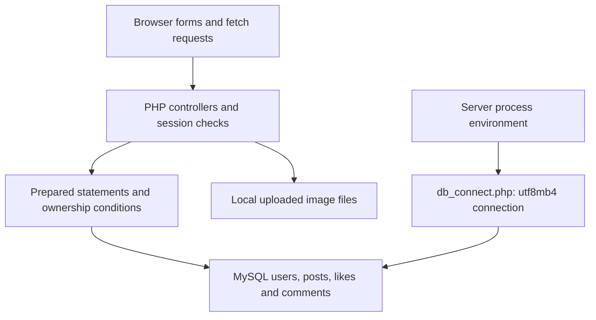

# Friendzone PHP web coursework: architecture and maintenance

Reviewed source: `781b5d742b136579c3138905439c4cd7038b5292`. Maintenance date: 11 November 2026. This document describes inspected code, the bounded fixes in this change and future work separately. It does not establish production deployment or measured scale. Original coursework/learning material and prior authorship remain identifiable; this maintenance was AI-assisted.

## Implemented architecture



| Component | Source | Responsibility |
| --- | --- | --- |
| Authentication | login.php, logincode.php, signupcode.php | Forms, password hashing/verification and sessions. |
| Social features | posts.php, submit_post.php, delete_post.php, friends.php, myposts.php | Server-rendered posts and mutations; some fetch enhancement. |
| Connection | db_connect.php | Shared environment-based configuration, generic failure response and utf8mb4. |
| Storage | MySQL plus uploads directory | Schema, fixtures and assets are not fully provided in this source snapshot. |

## Engineering decisions in this change

HTML comments/whitespace before session_start and header calls are removed from controllers. Login, signup and friends now use one environment-configured database connection rather than repeated root credentials. Delete requests no longer write request payloads to debug.txt. This maintenance is dated separately from the coursework.

## Reproduce checks and run

Run from the repository root with Python 3.12 or Node 22 as appropriate. Use a virtual environment before installing Python dependencies.

```bash
python tests/source_checks.py
find . -name "*.php" -print0 | xargs -0 -n1 php -l
```

4 Python source checks cover header ordering, preserved authentication logic, environment configuration and absence of payload debug writes. GitHub CI additionally runs PHP syntax checks; no database or browser integration claim is made.

## Current boundaries

This is not ready for Internet exposure. Missing schema/fixtures prevent a full MySQL integration run here. CSRF controls, upload MIME/size checks and server-side non-executable upload policy, pagination/N+1 query removal and consistent mutation transactions remain explicit work. Current source cleanup does not remove historical repository data. Do not treat PHP lint as a security certification.

## Scaling path and acceptance evidence

First complete authenticated mutation/CSRF and upload integration tests with a disposable database. Add bounded keyset pagination and joined aggregate queries for post feeds, indexed ownership/foreign keys and transactional deletes. Externalize uploads and session storage only when multiple web workers are introduced; enforce limits and backups before load tests. Measure query count, p95 latency and peak memory per feed page.

## Maintenance and recovery

Keep data and credentials out of source changes. Reproduce a failure with synthetic inputs before modifying a transformation or user action. Run the focused CI checks, review changes to input/output contracts and retain the prior commit for rollback. Back up local CSV/database inputs outside the working tree before manual runs. Revert the maintenance commit to roll back code; preserve data separately because reverting code does not reverse data mutations. Record environment versions, input schema, failure steps and expected/actual behavior in future bug reports.
