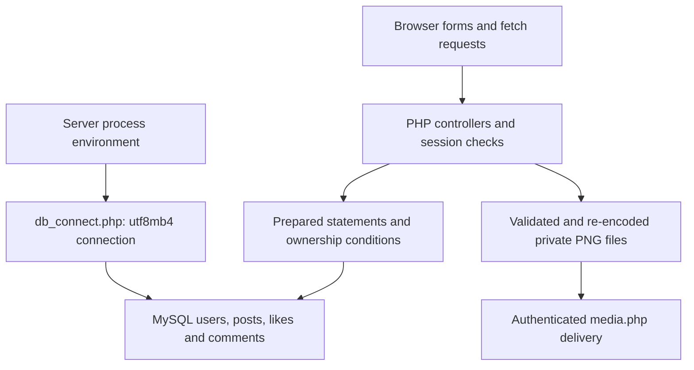

# Friendzone PHP web coursework: architecture and maintenance

Reviewed source: `781b5d742b136579c3138905439c4cd7038b5292`. Maintenance date: 11 November 2026. This document describes inspected code, the bounded fixes in this change and future work separately. It does not establish production deployment or measured scale. Original coursework/learning material and prior authorship remain identifiable; this maintenance was AI-assisted.

## Implemented architecture



| Component | Source | Responsibility |
| --- | --- | --- |
| Authentication | login.php, logincode.php, signupcode.php | Forms, password hashing/verification and sessions. |
| Social features | posts.php, submit_post.php, delete_post.php, friends.php, myposts.php | Server-rendered posts and mutations; some fetch enhancement. |
| Connection | db_connect.php | Shared environment-based configuration, generic failure response and utf8mb4. |
| Media storage | uploads.php and media.php | MIME, byte/pixel checks and PNG re-encoding; random names outside the web root, served only to authenticated sessions. |
| Sessions and request integrity | security.php | Strict cookie sessions and constant-time CSRF token verification before POST processing. |
| Database | MySQL | Original schema and assets are not fully supplied; database integration remains a separate validation gap. |

## Engineering decisions in this change

HTML comments/whitespace before session_start and header calls are removed from controllers. Login, signup and friends now use one environment-configured database connection rather than repeated root credentials. Delete requests no longer write request payloads to debug.txt. All POST requests now require a session-bound CSRF token; each form emits it, JSON endpoints accept X-CSRF-Token, and mutation endpoints reject GET. Login regenerates and invalidates the old session ID and rotates the request token. Uploads use actual file MIME, a 2 MiB byte ceiling and 12-million-pixel ceiling (maximum dimension 5000); accepted JPEG/PNG/GIF rasters are decoded and re-encoded as PNG under random names. The raw filename is never used for storage. Database availability is checked before creating post/profile media; failed inserts discard only files registered as created in the current request, preserving existing/default images. Storage must resolve outside the web root and media.php requires authentication. Duplicate late deletion code and broken JavaScript event handling are removed. This maintenance is dated separately from the coursework.

## Reproduce checks and run

Run from the repository root with Python 3.12 or Node 22 as appropriate. Use a virtual environment before installing Python dependencies.

```bash
python tests/source_checks.py
find . -name "*.php" -print0 | xargs -0 -n1 php -l
php tests/security_contracts.php
python tests/http_security_tests.py -v
```

6 Python source checks cover header ordering, authentication preservation, database configuration, mutation-guard ordering, complete form-token coverage and removal of payload debug writes. PHP contracts exercise token matching and malformed tokens, real raster metadata/size/dimension checks and private storage boundaries. Real local PHP HTTP tests verify response statuses/cookies/forms, CSRF rejection before database access, POST-only mutations, authentication gates and upload re-encoding/private media delivery. These checks require PHP 8.3 with gd, fileinfo and mysqli; GitHub CI executes them alongside syntax checks. No database integration or production load result is implied.

## Current boundaries

This is not ready for Internet exposure. Missing schema/fixtures prevent a full MySQL integration run here. Pagination, feed N+1 query consolidation and schema-level integration still need measured work; MySQL transactional behavior cannot be verified against the missing original schema. The JSON delete endpoint uses one locked ownership check and transactional child/post deletion, while existing form deletion retains its original transaction. The old database may reference uploads/ URLs; migrate those files and references explicitly before removing a legacy uploads directory. GIF uploads become a static PNG, so animation is intentionally not preserved. Current source cleanup does not remove historical repository data. Do not treat PHP lint as a security certification.

## Scaling path and acceptance evidence

Next complete original-schema authenticated mutation tests with a disposable database. Add bounded keyset pagination and joined aggregate queries for post feeds, indexed ownership/foreign keys and transactional deletes. Uploads are already outside the web root on one host; use shared object storage and shared session storage when introducing multiple web workers; enforce limits and backups before load tests. Measure query count, p95 latency and peak memory per feed page.

## Maintenance and recovery

Keep data and credentials out of source changes. Reproduce a failure with synthetic inputs before modifying a transformation or user action. Run the focused CI checks, review changes to input/output contracts and retain the prior commit for rollback. Back up local CSV/database inputs outside the working tree before manual runs. Revert the maintenance commit to roll back code; preserve data separately because reverting code does not reverse data mutations. Record environment versions, input schema, failure steps and expected/actual behavior in future bug reports.

## Local server configuration

Export DB_HOST, DB_NAME, DB_USER and DB_PASSWORD into the PHP process environment; .env.example documents names but is not automatically loaded. Set UPLOAD_DIRECTORY to a writable private directory outside the configured document root (default: a sibling friendzone-uploads directory). Keep it backed up with database references. Set SESSION_COOKIE_SECURE=1 when TLS terminates upstream, and serve the application over HTTPS in shared environments. With the original schema/assets supplied, a local development command is `php -S 127.0.0.1:8000 -t .`; the development server is not a production server. The test upload harness is disabled unless FRIENDZONE_TEST_MODE=1; never enable this test flag on a shared server.
